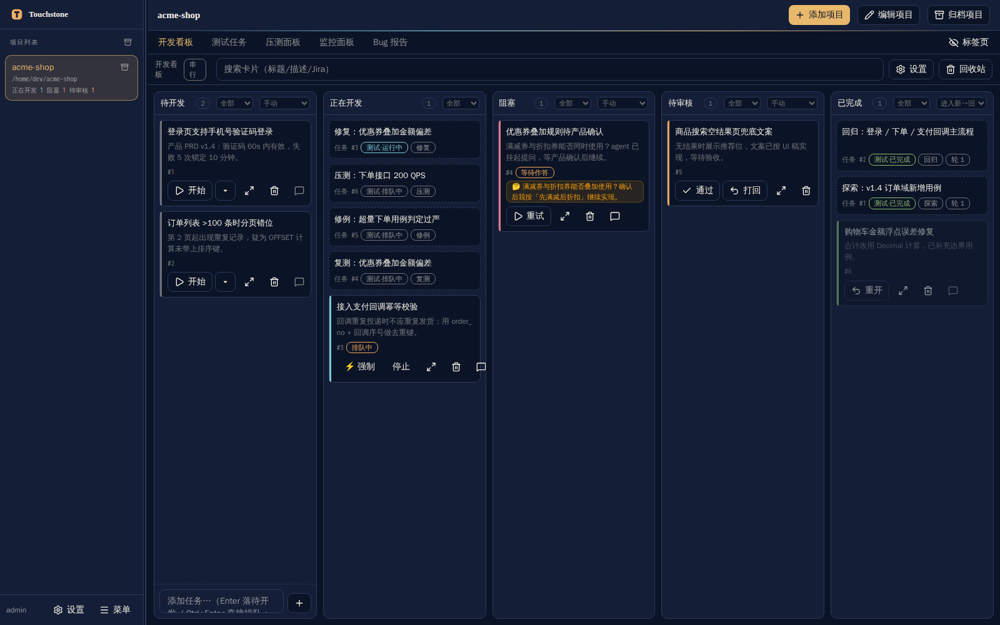
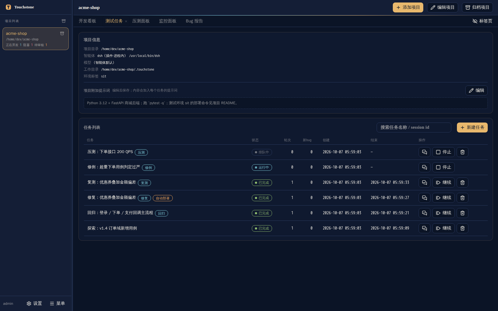
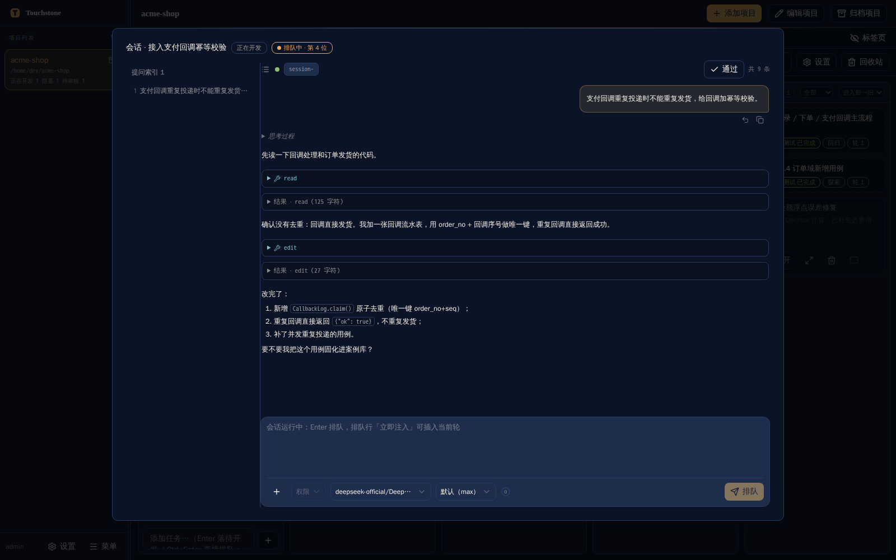
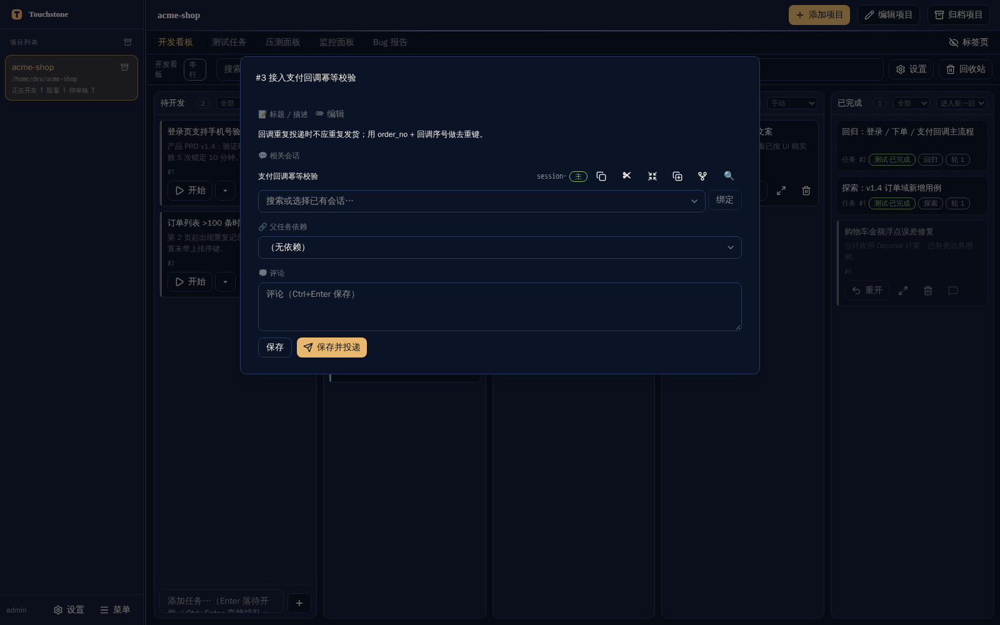
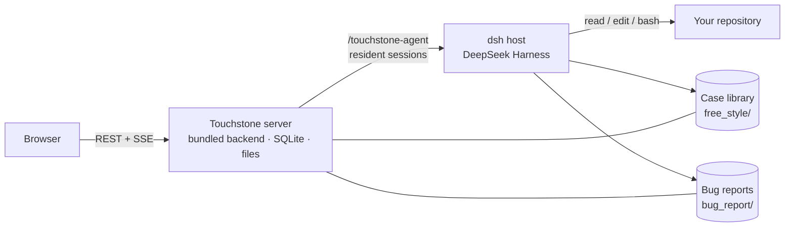

<div align="center">

# Touchstone

**An AI-agent-driven automated testing platform.** Point it at a repository; it explores the code, writes and runs test cases, files what breaks, fixes it, and re-verifies the fix.

[](LICENSE)
[](https://www.npmjs.com/package/@gavinc-cn/touchstone-dsh)
[](https://www.python.org/)
[](https://nodejs.org/)
[](https://github.com/deepseek-ai/deepseek-harness)

English | [中文](README.zh.md)

**[Quick start](#quick-start) · [Try the interactive demo](https://gavinc-cn.github.io/touchstone-dsh/en-demo.html)**



</div>

## What is Touchstone?

Touchstone turns "we really should test more" into a running loop. You register a project — its source
directory, a working directory, and the house rules the agent must follow — and
Touchstone drives an AI agent through [DeepSeek Harness](https://github.com/deepseek-ai/deepseek-harness)
(`dsh`) to **generate test cases, execute them, report failures as bug reports, fix the code, and
re-verify the fix**. Every artifact lands on disk in a reviewable form: a case library of Markdown case
files, a `bug_report/` directory, and per-round logs.

It is not a one-shot "run my test suite" CLI. Touchstone is built around **long-lived, multi-round agent
sessions**: a task runs round after round in the same session with its context intact, so the agent
remembers what it already tried. A unified queue keeps exactly one writer per project (no two agents
editing the same checkout at once), and the whole thing is observable — live round logs, a rendered
session window, and an SSE-backed board.

Touchstone runs **locally**. Standalone mode defaults to the bundled Node backend (Python via
`TS_BACKEND=python`); plugin mode also defaults to Node (since 2026-10-15, with `backend: python` as the
one-line fallback). Either way it is a SQLite database plus a file-system workspace, and no data leaves your
machine except for the model calls your `dsh` host makes.

## Quick start

Touchstone runs **inside [DeepSeek Harness](https://github.com/deepseek-ai/deepseek-harness) (`dsh`)**: the
platform serves its own UI from the `dsh` host, and the agent that writes and runs tests is that host's
agent. Nothing else has to be installed — no Python, no `git clone`.

**What you need:** Node.js **24.9+** (the floor of current `dsh` releases; Touchstone's own floor is 22.19),
a model route configured in `dsh`, and a repository you want tested.

> The panel UI is Chinese-only today. The commands below and every artifact on disk are language-neutral;
> where a label is Chinese, its meaning is given in parentheses.

### 1. Start `dsh` and give it a model

```bash
npx @deepseek-ai/dsh web
```

The first run creates the `web` profile under `~/.dsh/profiles/web` and prints a URL that carries an
access token (default port 3080). Open that URL, go to **Settings → Models**, and save a DeepSeek API key
(other providers and OpenAI-compatible endpoints work too). Leave this process running: it is the agent
runtime.

### 2. Install the Touchstone plugin

In a second terminal:

```bash
npx @deepseek-ai/dsh plugin --profile web add @gavinc-cn/touchstone-dsh
```

The package is self-contained (UI, both backends, prebuilt front end), and the install also adds it to the
profile's bundle list. No manifest to edit, no Python dependencies to install. `dsh` forwards this command to
pnpm: if pnpm is not on your PATH the command stops and says so — enable the shim that ships with Node
(`corepack enable pnpm`) and run it again.

### 3. Restart `dsh` and open the panel

Stop `dsh` (Ctrl+C) and start it again with the same command. A **Touchstone** entry now appears in the
sidebar — click it, or press **Alt+T**. The panel opens already signed in as `admin` (plugin mode is
password-free by default; set a password later under **设置 → 修改密码** (*Settings → Change password*)
in the panel).

### 4. Add your first project

In the panel, click **添加项目** (*Add project*) and fill in the form:

| Field | What to enter |
|-------|---------------|
| 项目名称 (*Project name*) | Any label, e.g. `my-service` |
| 项目目录 (*Project directory*) | Absolute path of the repository to test — the agent reads and edits it |
| 工作目录 (*Work directory*) | Leave empty to use `~/.touchstone/projects/<path id>`; cases and bug reports are written here |
| 智能体 (*Agent*) | Keep the scanned **dsh (plugin, in-process)** entry |
| 模型 (*Model*) | Leave empty for the `dsh` default; the list is the host's model catalog |
| 权限 (*Permission*) | The permission preset agent sessions run under; it can edit files and run commands |
| 项目附加提示词 (*Project guidance*) | How to build, test and deploy the project, plus the rules the agent must follow; injected into every first round |

The case library (`free_style/`) and `bug_report/` are created inside the work directory; nothing extra is
written into the tested repository.

### 5. Run one task and read the result

Open the **测试任务** (*Test tasks*) tab → **新建任务** (*New task*). The defaults are already what a first
run needs: type **探索** (*Exploration*), end stage **生成报告** (*Generate report*), stop after one round.
Give it a name and submit.

What happens, in order:

1. The task enters the project's queue (**排队中**, *queued*) and then starts (**运行中**, *running*). The
   queue is serial per project — one agent round at a time — so a second task waits for the first; different
   projects run in parallel.
2. The task detail refreshes its round log every couple of seconds, and the session window renders the
   full agent transcript (messages, reasoning, tool calls and results) as it grows.
3. When the round ends, `free_style/` under the work directory holds the new cases (`case.md` +
   `status.md`, plus an `INDEX.md`), and any failure has a directory under `bug_report/` (severity,
   reproduction steps, log evidence, related case).
4. The task finishes at **生成报告** and shows its round count and new-bug count.

Follow-up tasks close the loop: a bug report can spawn a fix task, a fix a retest, a rejected report a
case-revision task. See [How it works](#how-it-works) and [Task types](#task-types).

### If it doesn't work

| Symptom | Cause and fix |
|---------|---------------|
| No **Touchstone** entry in the sidebar | The package is not in the profile. Re-run step 2 and read its output; `~/.dsh/profiles/web/package.json` must list the package under `dependencies` and in `dsh.profile.bundles`. Then restart `dsh`. |
| The panel opens, but the page reports that the backend did not start | Another Touchstone instance already holds the database (`~/.touchstone/touchstone.db`). Only one runs at a time: stop the other one, or point this one at another database with `TOUCHSTONE_DB`. |
| A round ends instantly and leaves nothing | `dsh` has no usable model route. Configure one under **Settings → Models**; the session window shows only what the host reported, so a missing model looks like an empty round. |
| `dsh: pnpm was not found` | Enable Corepack's pnpm shim once (`corepack enable pnpm`) and re-run step 2. |
| The task sits in **排队中** | Another task or board card holds this project's serial slot. Wait for it, stop it, or use a different project. |
| Port 3080 is taken | Start `dsh` on another port: `dsh web --port 8081`. |
| The panel is not in your language | It is Chinese-only today (see [Capabilities and limits](#capabilities-and-limits)). |

Plugin backend diagnostics are appended to `~/.touchstone/plugin-backend.log`.

## Other ways to run

### Interactive demo

[Open the interactive demo](https://gavinc-cn.github.io/touchstone-dsh/en-demo.html) to walk the project,
task, board and session workflow in a browser tab. It is a static simulation: no backend, no repository and
no model calls.

### Standalone site (Node default, multi-user; optional agent execution)

For several people sharing one machine: a standalone process, ordinary login, one project list per user;
`dsh` only provides the agent runtime. Requires Node.js 22.19+ (site and front-end build). To let the site
execute agents, keep dsh and the Touchstone plugin running with `driverOnly: true` in the plugin config;
without a driver the site still logs in and browses, but tasks report "driver unavailable".

```bash
git clone https://github.com/gavinc-cn/touchstone-dsh.git
cd touchstone-dsh
./touchstone.sh start          # builds the front end on first run, then serves 127.0.0.1:4601
./touchstone.sh status         # PID and the actual port
./touchstone.sh stop
```

Open <http://127.0.0.1:4601>. The first start seeds an `admin` account; without `TS_ADMIN_PASSWORD` a
random one-time password is printed **once** in the startup banner:

```bash
grep '一次性初始口令' .run/server.log
```

First login forces a password change. Set `TS_ADMIN_PASSWORD=<your-password>` before the first start to skip
the one-time password and the forced change.

**Let the standalone site execute agents**: keep dsh and the plugin running, but turn the plugin into a
driver-only provider (no second backend):

```yaml
- id: touchstone-dsh
  config: { driverOnly: true }
```

The plugin writes a 0600 driver endpoint file; the standalone site reads it and reconnects after dsh restarts
or changes ports. The Touchstone sidebar entry is hidden in driver-only mode; use the standalone URL.

**Multi-user and the boundary**: the standalone site has ordinary login/registration and admin user
management; each user sees only their own projects, and admin only manages accounts. This is a **logical
separation for a trusted team, not a security sandbox**: anyone who can reach the port can self-register,
directory browsing is open to every logged-in user, and agents run as the dsh OS user. Creating or editing a
project is rejected when `project_dir`/`work_dir` is already used by another user (same-user duplicates
still warn but can be saved).

The standalone site and the plugin share one database (`~/.touchstone/touchstone.db`) and are mutually
exclusive while running: the second instance refuses to start and names the current holder. Driver-only mode
does not take the database lock.

### Python backend (legacy fallback; this batch's behavior is Node-only)

The standalone site defaults to Node; for the old backend set `TS_BACKEND=python` and install Python deps:

```bash
python3 -m pip install -r backend_py/requirements.txt
TS_BACKEND=python ./touchstone.sh start
# Windows: python -m pip install -r backend_py\requirements.txt
#          set TS_BACKEND=python && python touchstone.py start
```

The plugin's default backend is also Node. To roll back, set `backend: python` in the plugin config
(deleting the key does not change the default) and install that backend's dependencies with pip, not npm:

```bash
pip install -r ~/.dsh/profiles/web/node_modules/@gavinc-cn/touchstone-dsh/backend_py/requirements.txt
# Windows: python -m pip install ...   (the official installer ships python.exe, not python3)
```

This batch's driver-only handoff, cross-user duplicate-directory rejection and multi-user standalone site
are **Node-only**; the Python side is unchanged (no driver.json, no cross-user rejection). The plugin probes
`python`, then `python3`, and uses the first interpreter that runs. If that is not where you installed the
dependencies, pin another interpreter in the profile patch:

```yaml
- id: touchstone-dsh
  config: { backend: python, pythonPath: /path/to/python }
```

### From a checkout (development)

```bash
git clone https://github.com/gavinc-cn/touchstone-dsh.git
cd touchstone-dsh
./dsh-plugin/install.sh           # idempotent install of this checkout into the profile
```

The installer prints an optional profile patch for pointing the plugin at your working copy or choosing a
specific interpreter; skip it to use the package's own directory:

```yaml
- id: touchstone-dsh
  config: { repoDir: /path/to/touchstone-dsh, pythonPath: /path/to/python3 }
```

### Windows

The cross-platform launcher offers the same commands for the standalone site and **also defaults to the Node
backend** (Node.js 22.19+ required; the launcher itself is a Python script, so Python 3.12+ is still needed to
run it). The plugin is installed the same way as on Linux:

```bash
python touchstone.py start | stop | restart | status | build | test
```

## Highlights

- **Six task types** covering the whole QA loop — exploration, regression, stress, fix, retest, and case
  revision — each following a seven-stage lifecycle (generate cases → execute → report → analyze → fix →
  deploy → retest).
- **A case library, not a test log.** Cases are human-readable Markdown (`case.md` + `status.md` per
  case, plus an `INDEX.md` per directory). Agents read and extend them across tasks; you can fix a bad
  case by editing a file.
- **Bug reports as first-class artifacts.** Failures are written up as structured reports (severity,
  reproduction steps, log evidence, related cases) and can be routed back into fix / retest / case-revision
  tasks from the UI.
- **Unified per-project queue.** Tasks, board cards, and chat messages all take the same serial slot per
  project; queue position, the current holder, and evidence are queryable rather than guessed.
- **A board for agent-driven development.** Kanban cards start, queue, block, and complete agent sessions;
  cards can run in an isolated `git worktree` so exploratory work never touches your main checkout.
- **Observable sessions.** Render the full transcript of any agent session (messages, reasoning, tool
  calls, results), reply to it, inject into the running turn, compact it, fork it, or rewind to an earlier
  point through a fork.
- **Stress testing built in.** A stress task asks the agent for a scenario + script; the platform then
  drives the load itself, N runs per task, with per-run metrics, charts, and Markdown/JSON reports.
- **Optional integrations.** Feishu (Lark) push notifications with two-way answering from chat cards, and
  RAG-based semantic search over the case library.
- **Self-contained stack.** Backend: the bundled Node backend (default for both standalone and plugin;
  the site needs Node 22.19+, the dsh plugin itself needs 24.9+), or the Python standard library plus four
  small dependencies (legacy fallback: `TS_BACKEND=python` / `backend: python`). Frontend: React + Vite.
  Storage: SQLite + plain files. Runs on Linux and Windows.

## Screenshots

The development board — cards per column, task entries inline, per-project queue badges:


Test tasks — six task types, round counts, statuses, and per-task actions:



The session window — the full agent transcript rendered from the `dsh` session store, with reply,
approval, and model controls:



Card detail — description, scheduling, dependent cards, bound sessions, and comments:



## How it works



1. **You create a project.** Touchstone stores the repository path, a work directory, optional project
   skills, and free-form guidance that is injected into every first-round prompt.
2. **You create a task.** Pick a type (say, *Exploration*) and an end stage (say, *report*), and Touchstone
   queues it for that project.
3. **Rounds run in a resident agent session.** Touchstone asks the `dsh` plugin to create or resume a
   session and sends the round prompt. Rounds stream back to the UI and to
   `<work_dir>/.web/task_<id>_round_<n>.log` as they happen.
4. **Artifacts land in your work directory.** New cases under `free_style/`, bug reports under
   `bug_report/`, monitoring state under `.live/`. You review them like code.
5. **Follow-up tasks close the loop.** A report can spawn a fix task, a fix can spawn a retest, and a
   rejected report can spawn a case-revision task. When a task's end stage goes past "report", the
   platform appends the downstream stages as a follow-up task automatically.

### Task types

| Type | What the agent does | Typical end stage |
|------|---------------------|-------------------|
| Exploration | Reads the code and writes new test cases into the case library | Report |
| Regression | Re-runs existing cases (optionally limited to a commit date range) | Report |
| Stress | Produces a load scenario + driver script, then the platform runs the load | Report |
| Fix | Analyzes a bug report, patches the code, deploys, and re-tests | Fix / Deploy / Retest |
| Retest | Re-verifies one bug report (retest only, deploy + retest, or deploy only) | Retest |
| Case revision | Rejects a bug report as a bad case and rewrites the case instead | Revision |

### Core concepts

| Concept | Meaning |
|---------|---------|
| Project | A repository plus its work directory, agent binding, and guidance |
| Task | One queued unit of work: a task type, a stage range, a stop condition, and a round history |
| Round | One prompt/response cycle in the task's agent session |
| Case library | `<work_dir>/free_style/` — Markdown cases, status files, and per-directory indexes |
| Bug report | `<work_dir>/bug_report/<timestamp>_FS_<title>/` — the failure dossier for a case |
| Card | A board item that can start, queue, and drive its own agent session |
| Queue | The per-project serial slot shared by tasks, cards, and chat messages |

## Configuration

| Variable | Default | Purpose |
|----------|---------|---------|
| `TS_BACKEND` | `node` | Standalone backend: `node` (default) or `python` (legacy fallback) |
| `TS_PORT` / `TS_HOST` | `4601` / `127.0.0.1` | Listen address. Use `TS_HOST=0.0.0.0` to expose the site on your LAN |
| `TS_NODE` / `TS_NPM` | `node` / `npm` | Node executables used by the launcher (when not on PATH) |
| `TS_PYTHON` | `python3` | Interpreter for the Python fallback (must have the runtime dependencies) |
| `TS_AGENT_DRIVER_FILE` | `~/.touchstone/driver.json` | Driver endpoint file the standalone site reads (written by the plugin's `driverOnly` mode) |
| `TOUCHSTONE_DB` | `~/.touchstone/touchstone.db` | SQLite database. Must live on a local disk — file locking does not work on CIFS/network shares |
| `TS_ADMIN_PASSWORD` | *(random, printed once)* | Initial `admin` password; setting it skips the forced change |
| `TS_ADMIN_PASSWORDLESS` | `1` in plugin mode | Seed `admin` with an empty password and no forced change (the plugin shell sets this); ignored when `TS_ADMIN_PASSWORD` is set |
| `TS_WEB_DIR` | `webui/dist` | Static front-end directory the server serves |
| `TOUCHSTONE_RUN_DIR` | `.run/` in the repository | PID / log / port files |
| `TS_EXT_DIR` | `extensions` | Root of the built-in asset manifests |
| `TS_ARCHIVE_SYNC` | `1` | Keep board "Done" and `dsh` session archive in sync (set `0` to disable) |
| `TS_DSH_PROFILE` / `TS_DSH_PYTHON` | `web` / auto-detected | `dsh` profile and interpreter used by the plugin installer |

Runtime paths inside a project's work directory:

| Path | Contents |
|------|----------|
| `free_style/` | Case library (cases, status files, indexes) |
| `bug_report/` | Bug reports, one directory per report |
| `.web/` | Round logs, chat logs, stress metrics and reports |
| `.live/live.json` | Agent live state used by the monitoring page |
| `board_media/` | Attachments pasted onto board cards |

## Capabilities and limits

| Area | Supported |
|------|-----------|
| Agent sessions | Create, resume, reply, inject into the running turn, cancel, compact, fork, rewind-by-fork, model and permission-preset switching (presets follow your DSH permission catalog) |
| Session observability | Full transcript rendering, archive state, attachment preview, live status stream (no polling) |
| Tasks | Six types, seven stages, stop conditions, date-range scoping, per-round logs, restart, continue |
| Board | Cards across five columns, drag & drop, queue position, parent dependencies, scheduled start, trash, isolated worktrees |
| Case library | Derived indexes, change-based retest triage, optional semantic (RAG) search |
| Stress testing | Scenario validation, concurrent load, second-by-second metrics, charts, Markdown/JSON reports per run |
| Notifications | Feishu (Lark) outbound push, inbound commands, and answering questions from chat cards |
| Multi-user | Login, admin/user roles, per-project ownership checks on every project-scoped endpoint |

Known limitations, stated plainly:

- **The UI is currently Chinese-only.**
- **Agent execution requires a dsh driver**: plugin mode has one natively; standalone mode gets one by
  running the plugin with `driverOnly`. Without a driver, the standalone site still logs in and browses, but
  tasks/cards report "driver unavailable".
- **Rewind and "compact into a new session" are approximations** — rewind starts a new branch at an
  earlier point (the original session is kept), rather than truncating in place.
- **No error banner for failed model requests** — `dsh` has no event for it, so the session window shows
  what the host reported and nothing more.
- **The Windows launcher is implemented but `dsh` itself has not been verified on Windows yet.**
- **End-to-end test scripts are not distributed** in this repository (see below), so `test-full` and
  `test-ui` report a skip rather than running.

## Repository layout

```
touchstone-dsh/
├── backend/             Node backend (default for standalone and plugin): server.js + lib/ + routes/ + schema/
├── backend_py/          Python backend: server.py, runner.py, waitq.py, board.py, chat.py, db.py, …
│                        (+ requirements.txt). Legacy fallback (TS_BACKEND=python / backend: python);
│                        this batch's Node-only behavior is not mirrored there
├── builtin_prompts/     Prompt assets injected into first-round prompts
├── dsh-plugin/          The dsh plugin package (thin Node shell + driver + client bundle)
│                        + autocommit/ (auto-commit guard, bundle row 2, shipped in the package)
├── extensions/          Built-in asset manifest root (empty: its only asset moved into dsh-plugin/autocommit/)
├── webui/               React + Vite front end
├── tests/               pytest / vitest suites and the isolated-instance harness
└── touchstone.sh|py|cmd Launchers (Linux / cross-platform / Windows)
```

## Development

```bash
./touchstone.sh build        # install front-end deps and build webui/dist
./touchstone.sh test         # backend pytest + front-end vitest
./touchstone.sh test-full    # + isolated end-to-end scripts (scripts are not distributed here)
./touchstone.sh test-ui      # Playwright end-to-end (needs a running site; scripts not distributed)
cd webui && npm run dev      # front-end dev server on :5173, /api proxied to :4601
```

Optional commit gate:

```bash
git config core.hooksPath githooks   # pre-commit runs the fast test layer (SKIP_TS_TESTS=1 to skip once)
```

See [tests/README.md](tests/README.md) for the test matrix and prerequisites.

## Security notes

- The site listens on `127.0.0.1` by default and requires a login. Exposing it (`TS_HOST=0.0.0.0`) puts it
  on your network — do that deliberately.
- Every project-scoped endpoint checks ownership before returning data; the `admin` account is the only
  administrator and cannot be renamed or deleted.
- The agent runs with the permission preset you configure. The default is the most permissive one (no
  approval prompts), which is convenient and sharp-edged: **review the project guidance and the preset
  before pointing it at a repository you care about.**
- Passwords are stored with the hashing scheme the project was specified against (unsalted MD5 for new
  passwords, PBKDF2-SHA256 for legacy seed accounts). Treat this as a local-development-grade store.

## License

[MIT](LICENSE) © Touchstone contributors
