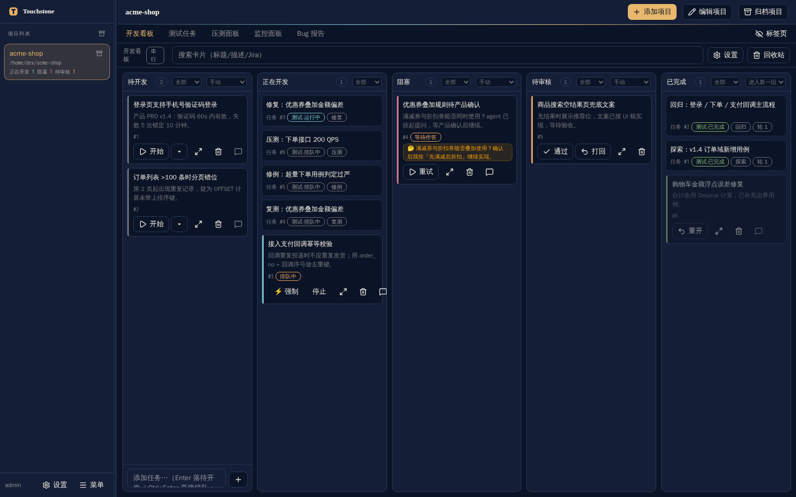
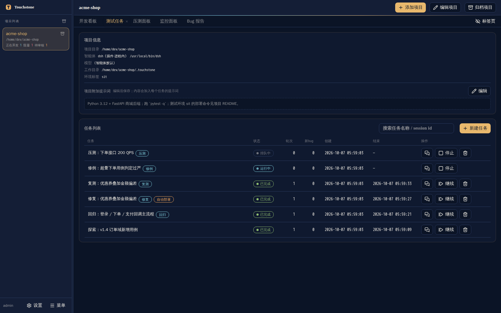
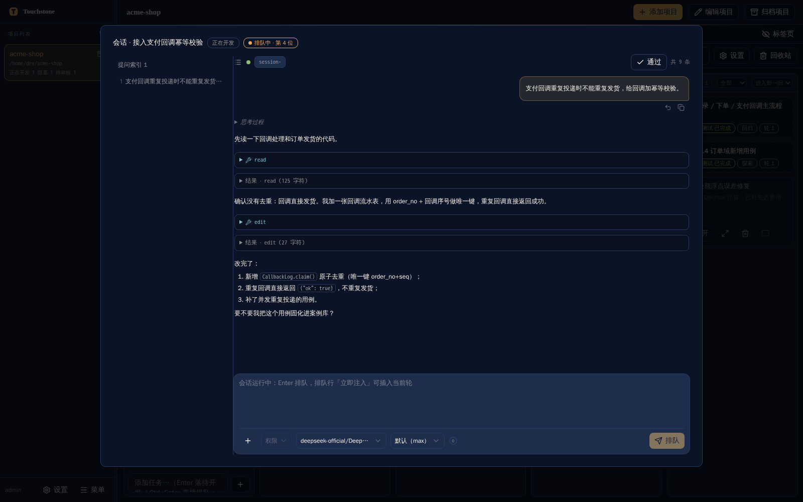
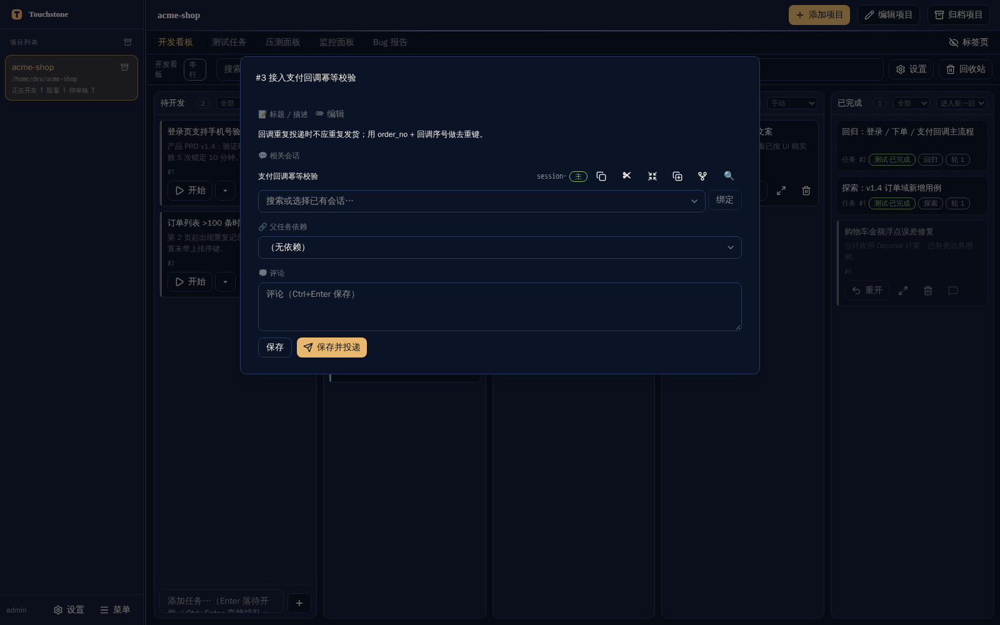
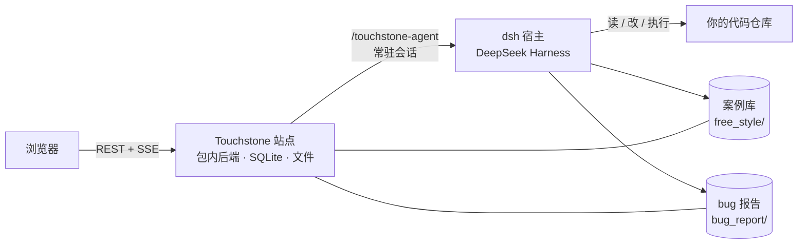

<div align="center">

# Touchstone（试金石）

**AI agent 驱动的自动化测试平台。** 把它指向一个代码仓库，它会读代码、写用例、跑用例，
把失败沉淀成 bug 报告，修完再复测一遍。

[](LICENSE)
[](https://www.npmjs.com/package/@gavinc-cn/touchstone-dsh)
[](https://www.python.org/)
[](https://nodejs.org/)
[](https://github.com/deepseek-ai/deepseek-harness)

[English](README.md) | 中文

**[快速开始](#快速开始) · [在线体验交互 Demo](https://gavinc-cn.github.io/touchstone-dsh/demo.html)**



</div>

## Touchstone 是什么

Touchstone 把「我们真该多测一点」变成一条持续转动的流水线。你登记一个项目——源码目录、
工作目录、以及要求 agent 遵守的项目约定——Touchstone 就会通过
[DeepSeek Harness](https://github.com/deepseek-ai/deepseek-harness)（`dsh`）驱动 AI agent：
**生成测试用例 → 执行 → 把失败写成 bug 报告 → 修代码 → 再复测**。所有产物都以可直接审阅的形式
落在磁盘上：Markdown 写的案例库、`bug_report/` 目录、以及逐轮日志。

它不是「跑一遍我的测试」的一次性 CLI。Touchstone 的核心是**多轮常驻 agent 会话**：一个任务在同一
会话里一轮接一轮地跑，上下文不断档，agent 记得自己试过什么。统一队列保证同一个项目同一时刻只有
一个写者（不会有两个 agent 同时改同一份检出），并且全流程可观测——逐轮实时日志、可渲染的会话窗口、
以及基于 SSE 的看板。

Touchstone 是**本地运行**的：独立形态是 Python 站点；插件形态自 2026-10-15 起缺省走包内 Node 后端
（要回 Python 就在插件 config 里显式写 `backend: python`）。两种形态都是 SQLite + 文件系统工作区，
除了你的 `dsh` 宿主发起的模型调用之外，数据不出本机。

## 快速开始

Touchstone 跑在 [DeepSeek Harness](https://github.com/deepseek-ai/deepseek-harness)（`dsh`）**里面**：平台
把自己的界面挂在 `dsh` 宿主进程内，写用例、跑用例的就是宿主里那个 agent。除此之外不用再装任何东西——
不需要 Python，也不需要克隆本仓库。

**开始前需要：** Node.js **24.9+**（当前 `dsh` 的门槛；Touchstone 包自身的门槛是 22.19）、`dsh` 里配好
一个模型路由，以及一个你希望被测的仓库。

> 面板界面目前只有中文；下面的命令与落到磁盘的产物都与语言无关。

### 1. 启动 `dsh` 并配置模型

```bash
npx @deepseek-ai/dsh web
```

首次运行会创建 `web` profile（`~/.dsh/profiles/web`），并打印一个带访问令牌的地址（默认 3080 端口）。
打开那个地址，进 **设置 → 模型**（Settings → Models）保存一个 DeepSeek API key（其它 provider 与 OpenAI
兼容端点同样支持）。**这个进程要保持运行**——它就是 Touchstone 要驱动的 agent 运行时。

### 2. 安装 Touchstone 插件

另开一个终端：

```bash
npx @deepseek-ai/dsh plugin --profile web add @gavinc-cn/touchstone-dsh
```

包是自包含的（界面、两套后端、预构建前端），安装时会同时把它加进 profile 的 bundle 列表——不用手改任何
清单，也不需要装 Python 依赖。这条命令由 `dsh` 转发给 pnpm：PATH 上没有 pnpm 时它会停下来说明——用
`corepack enable pnpm` 启用 Node 自带的 shim，再重跑一次即可。

### 3. 重启 `dsh`，打开面板

Ctrl+C 停掉 `dsh`，用同一条命令再启动。侧栏这时会多出 **Touchstone** 入口——点它，或按 **Alt+T**。
面板打开时已经以 `admin` 登录（插件形态默认免密；之后可在面板里的 **设置 → 修改密码** 设置口令）。

### 4. 添加第一个项目

在面板里点 **添加项目**，按下面填：

| 字段 | 填什么 |
|------|--------|
| 项目名称 | 随便起，例如 `my-service` |
| 项目目录 | 被测仓库的绝对路径——agent 会读它、改它 |
| 工作目录 | 留空即 `~/.touchstone/projects/<项目路径 id>`；案例库与 bug 报告落在这里 |
| 智能体 | 保持扫描到的 **dsh（插件·进程内）** 那一条 |
| 模型 | 留空用 `dsh` 默认；列表来自宿主的模型目录 |
| 权限 | 任务与卡片会话运行的权限档；它能够改文件、执行命令 |
| 项目附加提示词 | 怎么构建/测试/部署这个项目，以及 agent 必须遵守的约定；注入每轮首轮提示词 |

案例库（`free_style/`）与 `bug_report/` 会在工作目录里自动建好，被测仓库里不会多出任何目录。

### 5. 跑一个任务，看它留下什么

进 **测试任务** 标签页 → **新建任务**。默认值就是第一次跑该用的：类型 **探索**、终点 **生成报告**、
停止条件 **1 轮**。起个名字，提交。

接下来会依次发生：

1. 任务进入项目队列（**排队中**），随后开跑（**运行中**）。队列按项目串行——一个项目同一时刻只有一轮
   在跑，第二个任务排队等它；不同项目之间并行。
2. 任务详情里逐轮日志实时刷新；会话窗口边跑边渲染完整 agent 对话（消息、思考、工具调用与返回）。
3. 一轮结束后，工作目录下的 `free_style/` 里出现新用例（`case.md` + `status.md`，另有 `INDEX.md`）；
   有失败就是 `bug_report/` 下的一个目录（严重程度、复现步骤、日志证据、关联用例）。
4. 任务在 **生成报告** 阶段结束，列表里能看到轮次与新 bug 数。

后段任务负责闭环：报告可派生修复任务，修复派生复测，被否决的报告派生修例。细节见
[工作原理](#工作原理) 与 [任务类型](#任务类型)。

### 跑不起来时

| 现象 | 原因与处理 |
|------|-----------|
| 侧栏没有 **Touchstone** 入口 | 包没装进 profile。重跑第 2 步看输出；`~/.dsh/profiles/web/package.json` 的 `dependencies` 与 `dsh.profile.bundles` 都要有它，然后重启 `dsh`。 |
| 面板打开了，但页面提示后端没起来 | 已经有另一个 Touchstone 实例占着数据库（`~/.touchstone/touchstone.db`）。同一时刻只能跑一个：停掉另一个，或用 `TOUCHSTONE_DB` 让它用别的库。 |
| 一轮秒结束、什么也没留下 | `dsh` 没有可用的模型路由。去 **设置 → 模型** 配一个；会话窗只显示宿主回报的内容，缺模型看起来就是一轮空跑。 |
| 提示 `dsh: pnpm was not found` | 先 `corepack enable pnpm` 启用 Node 自带的 pnpm shim，再重跑第 2 步。 |
| 任务一直 **排队中** | 该项目还有任务或看板卡占着串行位。等它、停它，或换个项目。 |
| 3080 端口被占 | 换一个端口启动：`dsh web --port 8081`。 |
| 界面不是你的语言 | 目前只有中文（见 [能力与边界](#能力与边界)）。 |

插件形态的后端诊断日志在 `~/.touchstone/plugin-backend.log`。

## 其它运行方式

### 在线 Demo

[打开交互 Demo](https://gavinc-cn.github.io/touchstone-dsh/demo.html)，在浏览器里走一遍项目、任务、看板和
会话流程。它是**静态模拟**：不连后端、不读仓库、不发起模型调用。

### 独立站点（不能执行 agent）

适合浏览项目、案例库、bug 报告、看板与监控。界面与插件形态相同，但**不能执行 agent**——agent 只存在于
`dsh` 宿主进程内。需要 Python 3.12+。

```bash
git clone https://github.com/gavinc-cn/touchstone-dsh.git
cd touchstone-dsh
python3 -m pip install -r backend_py/requirements.txt
./touchstone.sh start          # 首次启动会自动构建前端，然后监听 127.0.0.1:4601
./touchstone.sh status         # 查看 PID 与实际端口
./touchstone.sh stop
```

浏览器打开 <http://127.0.0.1:4601>。首次启动会种子一个 `admin` 账号；未设置 `TS_ADMIN_PASSWORD` 时，
随机一次性初始口令**只在启动横幅打印一次**：

```bash
grep '一次性初始口令' .run/server.log     # 或：./touchstone.sh status
```

首次登录会被要求改密。想跳过一次性口令和强制改密，在首次启动前设置
`TS_ADMIN_PASSWORD=<你的口令>`。

独立站点与插件形态默认共用同一个数据库（`~/.touchstone/touchstone.db`），运行时互斥：第二个实例会拒绝
启动，并打印当前占用者。

### 插件形态改用 Python 后端

插件缺省后端是 Node。若要使用观测期回滚档，在插件 config 里显式写 `backend: python`（删掉该键不会改变
缺省值），并用 pip（不是 npm）安装该后端的依赖：

```bash
pip install -r ~/.dsh/profiles/web/node_modules/@gavinc-cn/touchstone-dsh/backend_py/requirements.txt
# Windows 用 python -m pip install ...（官方安装器只装 python.exe，没有 python3）
```

插件按 `python` → `python3` 的顺序探测，使用第一个能运行的解释器。如果探到的不是你装依赖的那支，可在
profile patch 里指定解释器：

```yaml
- id: touchstone-dsh
  config: { backend: python, pythonPath: /path/to/python }
```

### 从检出安装（开发用）

```bash
git clone https://github.com/gavinc-cn/touchstone-dsh.git
cd touchstone-dsh
./dsh-plugin/install.sh           # 幂等安装本检出到 profile
```

安装脚本会打印**可选**的 profile 覆盖（指向本机工作副本、或指定解释器）；不写就用包自身目录：

```yaml
- id: touchstone-dsh
  config: { repoDir: /path/to/touchstone-dsh, pythonPath: /path/to/python3 }
```

### Windows

跨平台启停器为独立站点提供同一套命令；插件按与 Linux 相同的方式安装：

```bash
python touchstone.py start | stop | restart | status | build | test
```

## 主要特性

- **六类任务**覆盖完整测试闭环：探索 / 回归 / 压测 / 修复 / 复测 / 修例，每类都走七阶段生命周期
  （生成用例 → 测试 → 生成报告 → 报告分析 → 问题修复 → 重新部署 → 复测）。
- **案例库而不是测试日志**。用例是可读的 Markdown（每个用例 `case.md` + `status.md`，每层目录一个
  `INDEX.md`）。agent 跨任务读写同一份案例库；用例写错了，你直接改文件就能修。
- **bug 报告是一等产物**。失败会写成结构化报告（严重程度、复现步骤、日志证据、关联用例），并可在
  界面上直接派生成修复 / 复测 / 修例任务。
- **按项目的统一队列**。任务、看板卡片、会话消息共用同一个项目级串行位；排队位次、当前占用者与
  判定证据都可查，不靠猜。
- **面向 agent 开发的看板**。卡片可以起跑、排队、阻塞、完成各自的 agent 会话；需要时在独立的
  `git worktree` 里跑，探索性改动不碰你的主检出。
- **会话可观测**。完整渲染任意 agent 会话的消息、思考、工具调用与返回；可续聊、可往当前轮注入、
  可压缩、可 fork、也可通过 fork 回退到更早的节点。
- **内置压测**。压测任务先让 agent 产出场景与脚本，之后由平台自己发压，一个任务可跑 N 次，每次都有
  指标、图表与 Markdown/JSON 报告。
- **可选集成**。飞书（Lark）推送通知与卡片双向作答；案例库的可选语义检索（RAG）。
- **自包含技术栈**。后端：包内 Node 后端（插件形态缺省，需 Node 24.9+）或 Python 标准库 + 4 个小依赖
  （独立形态 / `backend: python`）；前端：React + Vite；存储：SQLite + 普通文件。Linux 与 Windows 均可运行。

## 界面截图

开发看板——五列卡片、任务条目内联展示、项目级排队徽标：


测试任务——六类任务、轮次、状态与逐任务操作：



会话窗口——从 `dsh` 会话存储渲染出的完整对话（消息、思考、工具调用），带回复、审批与模型控件：



卡片详情——描述、定时开工、父任务依赖、绑定会话与评论：



## 工作原理



1. **建项目**：Touchstone 记录仓库路径、工作目录、可选的项目能力 skill，以及每轮首轮
   提示词都会注入的自由文本约定。
2. **建任务**：选类型（例如「探索」）与终点阶段（例如「生成报告」），入该项目的队列。
3. **多轮会话执行**：Touchstone 经 `dsh` 插件新建或续接一个常驻会话，下发本轮提示词；过程实时回流
   到界面，并写入 `<工作目录>/.web/task_<id>_round_<n>.log`。
4. **产物落到工作目录**：新用例进 `free_style/`，bug 报告进 `bug_report/`，监控状态进 `.live/`——
   你像审代码一样审它们。
5. **后段任务闭环**：报告可派生修复任务，修复可派生复测任务，被否决的报告可派生修例任务；当任务的
   终点越过「生成报告」时，平台会自动追加后段阶段任务。

### 任务类型

| 类型 | agent 做什么 | 常见终点 |
|------|--------------|----------|
| 探索 | 读代码并把新用例写进案例库 | 生成报告 |
| 回归 | 重跑已有用例（可限定提交日期范围） | 生成报告 |
| 压测 | 产出压测场景 + 驱动脚本，随后由平台发压 | 生成报告 |
| 修复 | 分析 bug 报告、改代码、部署并复测 | 问题修复 / 重新部署 / 复测 |
| 复测 | 针对一份 bug 报告复验（仅复测 / 部署后复测 / 仅部署） | 复测 |
| 修例 | 判定报告对应的用例本身有误，改写用例 | 修订用例 |

### 核心概念

| 概念 | 含义 |
|------|------|
| 项目 | 一个仓库 + 工作目录 + 智能体绑定 + 项目约定 |
| 任务 | 一个排队单元：任务类型、阶段范围、停止条件与轮次历史 |
| 轮次 | 任务会话里的一次「提示词 → agent 执行」循环 |
| 案例库 | `<工作目录>/free_style/`：Markdown 用例、状态文件与逐层索引 |
| bug 报告 | `<工作目录>/bug_report/<时间戳>_FS_<标题>/`：一条用例的失败档案 |
| 卡片 | 看板条目，可起跑、排队并驱动自己的 agent 会话 |
| 队列 | 任务 / 卡片 / 会话消息共享的项目级串行位 |

## 配置

| 环境变量 | 默认值 | 作用 |
|----------|--------|------|
| `TS_PORT` / `TS_HOST` | `4601` / `127.0.0.1` | 监听地址；`TS_HOST=0.0.0.0` 可对局域网开放 |
| `TS_PYTHON` | `python3` | 启停器使用的解释器（需装好运行依赖） |
| `TOUCHSTONE_DB` | `~/.touchstone/touchstone.db` | SQLite 数据库，必须放本地盘——文件锁在 CIFS/网盘上不可用 |
| `TS_ADMIN_PASSWORD` | *（随机，打印一次）* | `admin` 初始口令；设了就跳过强制改密 |
| `TS_WEB_DIR` | `webui/dist` | 站点托管的前端静态目录 |
| `TOUCHSTONE_RUN_DIR` | 仓库内 `.run/` | PID / 日志 / 端口标记文件目录 |
| `TS_EXT_DIR` | `extensions` | 内置资产清单根目录 |
| `TS_ARCHIVE_SYNC` | `1` | 看板「已完成」与 `dsh` 会话归档双向同步（置 `0` 关闭） |
| `TS_DSH_PROFILE` / `TS_DSH_PYTHON` | `web` / 自动探测 | 插件安装脚本使用的 `dsh` profile 与解释器 |

项目工作目录下的运行路径：

| 路径 | 内容 |
|------|------|
| `free_style/` | 案例库（用例、状态文件、逐层索引） |
| `bug_report/` | bug 报告，一份报告一个目录 |
| `.web/` | 逐轮日志、对话日志、压测指标与报告 |
| `.live/live.json` | 监控页数据源（agent 运行状态） |
| `board_media/` | 粘贴到看板卡片的附件 |

## 能力与边界

| 领域 | 支持情况 |
|------|----------|
| agent 会话 | 新建、续接、回复、往当前轮注入、中断、compact 压缩、fork、按 fork 回退、模型与权限档切换（权限档列表跟随你 DSH 的权限目录） |
| 会话可观测 | 完整对话渲染、归档状态、附件预览、实时状态流（零状态轮询） |
| 任务 | 六类型、七阶段、停止条件、日期范围限定、逐轮日志、重启、继续 |
| 看板 | 五列卡片、拖拽、排队位次、父任务依赖、定时开工、回收站、独立 worktree |
| 案例库 | 派生索引、按变更文件做复测粗筛、可选语义检索（RAG） |
| 压测 | 场景校验、并发发压、秒级指标、图表、每次运行独立的 Markdown/JSON 报告 |
| 通知 | 飞书推送、入站指令、在聊天卡片上直接作答 |
| 多用户 | 登录、admin/普通用户、所有按项目进入的接口都做归属校验 |

如实说明的已知限制：

- **界面目前只有中文。**
- **agent 执行必须走插件形态**；独立形态是「没有 agent 的站点」。
- **回退与「压缩并新建」是语义近似**——回退是从更早的节点另起一支（原会话保留），不是原地截断。
- **模型请求失败没有错误横幅**——`dsh` 没有对应事件通道，会话窗只能显示宿主真实回报的内容。
- **Windows 启停器已实现，但 `dsh` 在 Windows 上尚未实机验证。**
- **端到端测试脚本不随本仓分发**（见下），因此 `test-full` 与 `test-ui` 只会提示跳过。

## 仓库结构

```
touchstone-dsh/
├── backend/             Node 后端（插件形态缺省）：server.js + lib/ + routes/ + schema/
├── backend_py/          Python 后端：server.py、runner.py、waitq.py、board.py、chat.py、db.py……
│                        （+ requirements.txt）；「保留但不退役」，独立形态 / backend: python 走它
├── builtin_prompts/     注入首轮提示词的提示词资产
├── dsh-plugin/          dsh 插件包（Node 薄壳 + 驱动 + 客户端 bundle）
│                        + autocommit/（自动提交守卫，bundle 第二行，随包发）
├── extensions/          内置资产清单根（当前为空：唯一的资产已并进 dsh-plugin/autocommit/）
├── webui/               React + Vite 前端
├── tests/               pytest / vitest 套件与隔离实例夹具
└── touchstone.sh|py|cmd 启停入口（Linux / 跨平台 / Windows）
```

## 开发

```bash
./touchstone.sh build        # 安装前端依赖并构建 webui/dist
./touchstone.sh test         # 后端 pytest + 前端 vitest
./touchstone.sh test-full    # 追加隔离实例 e2e（本仓不随附这些脚本）
./touchstone.sh test-ui      # Playwright e2e（需站点在跑；本仓不随附这些脚本）
cd webui && npm run dev      # 前端开发服务器 :5173，/api 代理到 :4601
```

可选的提交门禁：

```bash
git config core.hooksPath githooks   # pre-commit 跑测试快层（SKIP_TS_TESTS=1 单次跳过）
```

测试矩阵与前置条件见 [tests/README.md](tests/README.md)。

## 安全说明

- 站点默认只监听 `127.0.0.1` 并要求登录。用 `TS_HOST=0.0.0.0` 对外暴露等于把它放进你的网络里，
  请有意为之。
- 所有按项目进入的接口先做归属校验；`admin` 是唯一管理员，不可改名或删除。
- agent 以你配置的权限档运行，默认是限制最松的一档（免审批）。方便，但也锋利：**把它指向你在意的
  仓库之前，请先看清项目约定与权限档。**
- 口令存储沿用本项目既定的算法（新口令为无盐 MD5，历史种子账号为 PBKDF2-SHA256）。请把它当作
  本地开发级别的口令存储来对待。

## 许可证

[MIT](LICENSE) © Touchstone contributors
